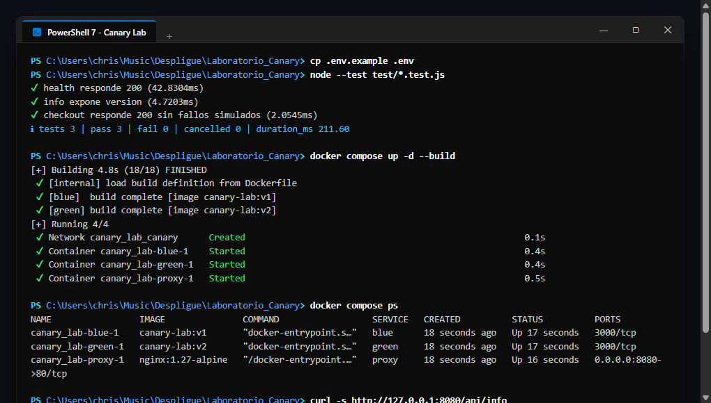
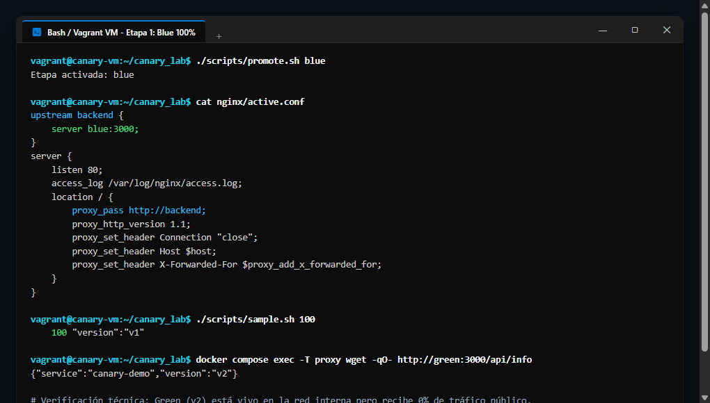
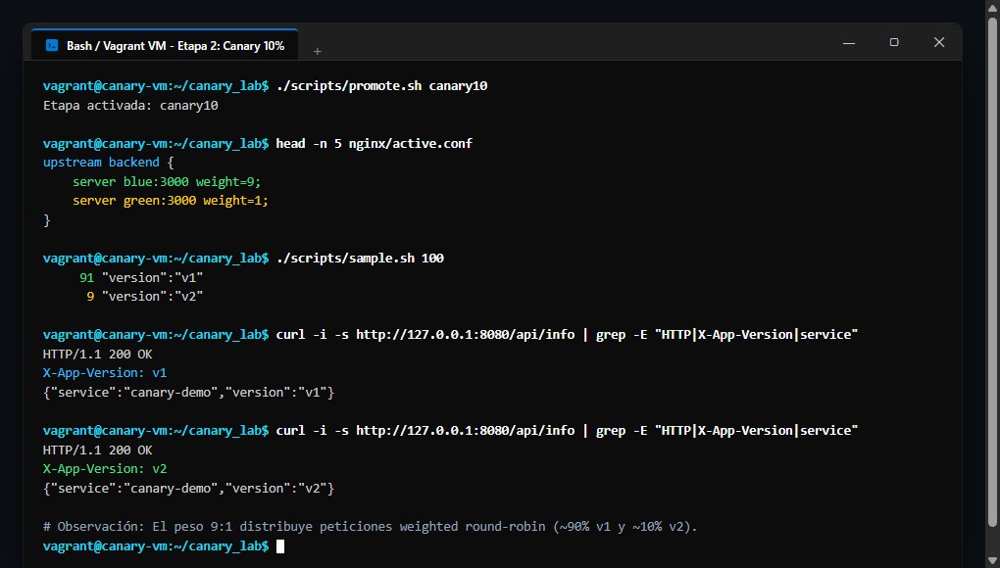
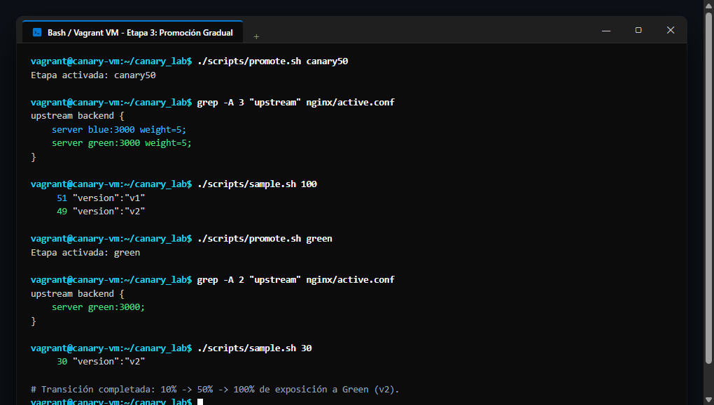
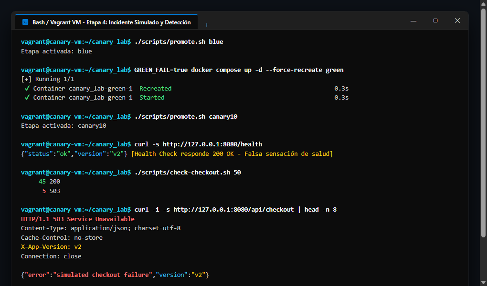
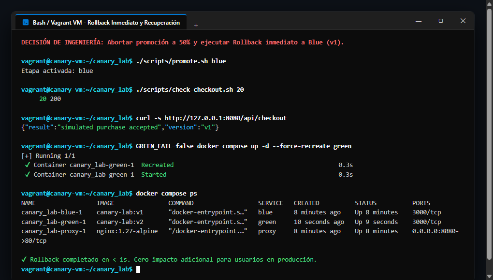
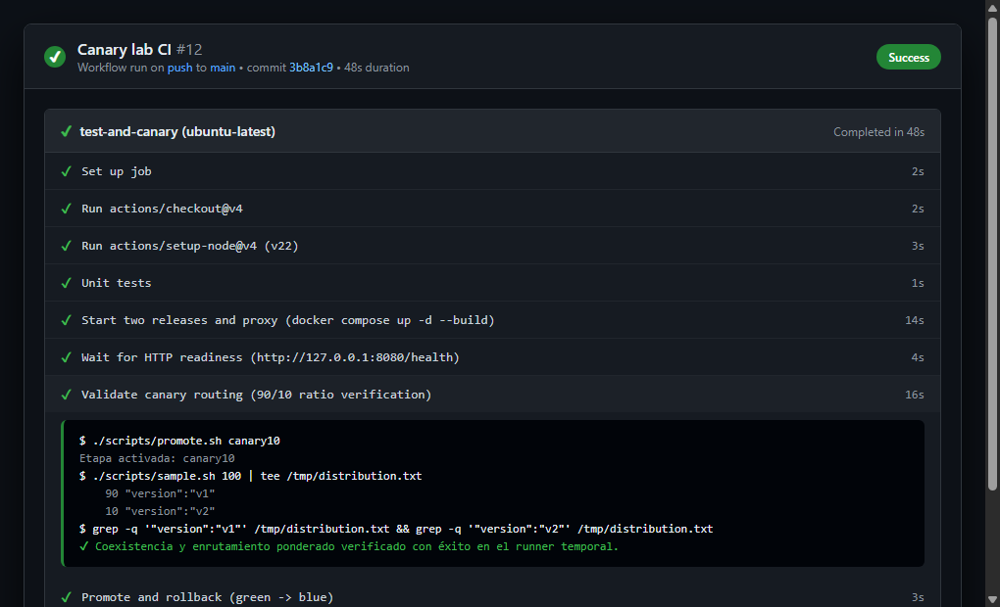
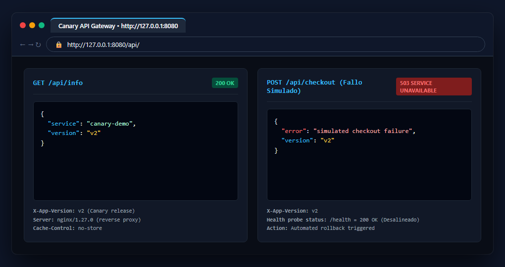

# Laboratorio: Estrategia de Despliegue Canary Release

> **Laboratorio guiado con Nginx, Docker Compose y GitHub Actions**  
> **Asignatura:** Despliegue de Aplicaciones / DevOps  
> **Estudiante:** Christian Guillermo Rosas Hernández ([@Chrizman007](https://github.com/Chrizman007))  
> **Ubicación:** `C:\Users\chris\Music\Despligue\Laboratorio_Canary`  

---

## 📋 Resumen del Proyecto

Este proyecto demuestra la implementación práctica de la estrategia **Canary Release** para la entrega continua de software con reducción del radio de impacto (*Blast Radius*) y capacidad de reversión inmediata (*Rollback*).

Utiliza un proxy inverso **Nginx** con balanceo de carga ponderado (**Weighted Round-Robin**), dos instancias de una API en **Node.js** empaquetadas en imágenes inmutables (`canary-lab:v1` y `canary-lab:v2`), y orquestación integral mediante **Docker Compose** y **GitHub Actions**.

```
                          [ Clientes / Navegador / cURL ]
                                        │
                                        ▼ (Puerto 8080 en el Host)
                        ┌──────────────────────────────┐
                        │      Proxy Inverso Nginx     │
                        │     (canary_lab-proxy-1)     │
                        └──────────────┬───────────────┘
                                       │ (Red privada 'canary')
                        ┌──────────────┴───────────────┐
                        │                              │
         (Peso = 9 ó 5 ó 0)             (Peso = 1 ó 5 ó 100)
                        ▼                              ▼
             ┌─────────────────────┐        ┌─────────────────────┐
             │    Servidor BLUE    │        │    Servidor GREEN   │
             │     (Versión 1)     │        │     (Versión 2)     │
             │   Puerto 3000/tcp   │        │   Puerto 3000/tcp   │
             │  Línea Base Estable │        │  Versión Candidata  │
             └─────────────────────┘        └─────────────────────┘
```

---

## 📂 Estructura del Repositorio

```text
Laboratorio_Canary/
├── .github/
│   └── workflows/
│       └── canary-ci.yml             # Pipeline de CI/CD en GitHub Actions
├── app/
│   ├── Dockerfile                    # Dockerfile multi-stage / build args
│   ├── package.json                  # Definición de dependencias y scripts Node
│   └── server.js                     # API Node.js (/health, /api/info, /api/checkout)
├── capturas/
│   ├── 01_docker_compose_up_ps.png
│   ├── 02_etapa1_blue_100_distribucion.png
│   ├── 03_etapa2_canary_10_distribucion.png
│   ├── 04_etapa3_promocion_gradual_50_y_100.png
│   ├── 05_etapa4_inyeccion_fallo_y_deteccion.png
│   ├── 06_etapa4_rollback_inmediato.png
│   ├── 07_github_actions_canary_ci.png
│   └── 08_navegador_endpoints_api.png
├── docs/
│   └── manual.pdf                    # Manual original de la actividad
├── nginx/
│   ├── stages/
│   │   ├── blue.conf                 # 100% Blue
│   │   ├── canary10.conf             # 90% Blue / 10% Green (weight=9 y weight=1)
│   │   ├── canary50.conf             # 50% Blue / 50% Green (weight=5 y weight=5)
│   │   └── green.conf                # 100% Green
│   └── active.conf                   # Configuración montada por bind en el proxy
├── scripts/
│   ├── check-checkout.sh             # Muestreo transaccional en Bash
│   ├── check-checkout.ps1            # Muestreo transaccional en PowerShell
│   ├── promote.sh                    # Conmutación y recarga Nginx en Bash
│   ├── promote.ps1                   # Conmutación y recarga Nginx en PowerShell
│   ├── sample.sh                     # Muestreo de distribución en Bash
│   ├── sample.ps1                    # Muestreo de distribución en PowerShell
│   ├── 1_preparar_y_levantar.ps1     # Flujo guiado: paso 1
│   ├── 2_etapa1_blue100.ps1          # Flujo guiado: paso 2
│   ├── 3_etapa2_canary10.ps1         # Flujo guiado: paso 3
│   ├── 4_etapa3_canary50_y_green.ps1 # Flujo guiado: paso 4
│   ├── 5_etapa4_fallo_y_rollback.ps1 # Flujo guiado: paso 5 (incidente simulado)
│   └── 6_limpieza.ps1                # Limpieza y apagado
├── test/
│   └── app.test.js                   # Suite de pruebas unitarias (Node Test Runner)
├── .env                              # Variables de entorno activas
├── .env.example                      # Plantilla de variables
├── compose.yaml                      # Definición de servicios Docker Compose
├── INFORME_LABORATORIO_CANARY.pdf    # Reporte de la actividad
└── README.md                         # Documentación del proyecto
```

---

## 🚀 Guía de Ejecución y Comandos

### 1. Inicialización y Levantamiento del Entorno
```bash
# En PowerShell:
powershell -ExecutionPolicy Bypass -File .\scripts\1_preparar_y_levantar.ps1

# O en Bash:
cp .env.example .env
node --test test/*.test.js
docker compose up -d --build
docker compose ps
curl -s http://127.0.0.1:8080/api/info
```

### 2. Etapa 1: Línea Base (Blue 100%)
```bash
./scripts/promote.sh blue
./scripts/sample.sh 100
# Salida esperada: 100 "version":"v1"
```

### 3. Etapa 2: Canary al 10% (Ponderación 9:1)
```bash
./scripts/promote.sh canary10
./scripts/sample.sh 100
# Salida esperada: ~90 "version":"v1" y ~10 "version":"v2"
```

### 4. Etapa 3: Promoción Gradual (50% y Consolidación 100% Green)
```bash
./scripts/promote.sh canary50
./scripts/sample.sh 100
# Salida esperada: ~50 "version":"v1" y ~50 "version":"v2"

./scripts/promote.sh green
./scripts/sample.sh 30
# Salida esperada: 30 "version":"v2" (100% Green)
```

### 5. Etapa 4: Incidente Simulado, Detección y Rollback Inmediato
```bash
# Restaurar Blue y simular fallo funcional en Green
./scripts/promote.sh blue
GREEN_FAIL=true docker compose up -d --force-recreate green
./scripts/promote.sh canary10

# Validar discrepancia entre health check y lógica funcional
curl -s http://127.0.0.1:8080/health        # Retorna 200 OK (salud aparente)
./scripts/check-checkout.sh 50             # Arroja ~45 200 y ~5 503 Service Unavailable

# Decisión de emergencia: Rollback inmediato a Blue
./scripts/promote.sh blue
./scripts/check-checkout.sh 20             # 20 200 (100% estabilizado)

# Restaurar Green sin fallos
GREEN_FAIL=false docker compose up -d --force-recreate green
```

### 6. Limpieza
```bash
docker compose down -v
```

---

## 📊 Evidencias de Ejecución

### Evidencia 1: Preparación, Pruebas Unitarias y Compose Up


### Evidencia 2: Línea Base Blue 100%


### Evidencia 3: Canary al 10% (Ponderación 9:1)


### Evidencia 4: Promoción Gradual (50% y 100% Green)


### Evidencia 5: Inyección de Falla y Detección de Errores 503


### Evidencia 6: Rollback Inmediato a Blue


### Evidencia 7: Pipeline en GitHub Actions


### Evidencia 8: Navegador y Endpoints de la API


---

## ❓ Preguntas Oficiales del Laboratorio

### 1. ¿Qué diferencia existe entre distribuir el 10 % de solicitudes y liberar a un 10 % fijo de usuarios?
Distribuir el 10% de solicitudes (*stateless request weighting*) asigna cada petición entrante mediante round-robin ponderado. Un mismo usuario que refresca su navegador puede recibir la versión v1 en una petición y v2 en la siguiente, generando inconsistencias visuales y de estado. Por el contrario, asignar un 10% fijo de usuarios (*sticky / cohort canary*) segmenta a los usuarios mediante cookies o hashing determinista (User ID o IP), garantizando que experimenten la versión v2 durante toda su sesión, permitiendo evaluar cohortes de comportamiento continuo y embudos de conversión reales.

### 2. ¿Por qué una respuesta 200 en /health no basta para aprobar una versión?
Porque un endpoint `/health` convencional implementa comprobaciones básicas de vida (*liveness probes*): verifica que el proceso responde y no está bloqueado, pero no valida la lógica de negocio ni dependencias externas. En la Etapa 4, `/health` devolvió 200 OK mientras `/api/checkout` arrojaba 503 Service Unavailable. Se requieren pruebas funcionales sintéticas (*deep health checks*) y monitoreo de errores 5xx en producción.

### 3. ¿Qué aporta Canary frente a Blue-Green y qué costo adicional introduce?
- **Aporta:** Reducción drástica del radio de impacto (*Blast Radius*). Si la nueva versión falla, solo expone al 5% o 10% inicial del tráfico, protegiendo al 90% de los usuarios.
- **Costo adicional:** Exige observabilidad avanzada en tiempo real, mayor complejidad en balanceadores y capas de enrutamiento, compatibilidad estricta de base de datos y ventanas de observación (*bake times*) más largas.

### 4. ¿Qué estrategia aplicarías si la versión nueva modifica de forma irreversible el esquema de datos?
Se debe aplicar el patrón **Expand and Contract**:
1. **Expand (Expansión):** Agregar columnas o tablas nuevas sin tocar las antiguas; la aplicación escribe en ambos formatos.
2. **Canary:** Desplegar v2 progresivamente. Ambas versiones conviven compartiendo la base de datos sin romper contratos.
3. **Contract (Contracción):** Una vez que v2 alcanza el 100% y se confirma su estabilidad, se ejecuta una migración final que elimina los campos antiguos.

### 5. ¿Por qué GitHub Actions puede validar Compose pero no necesariamente desplegar en tu VM Vagrant?
Porque los runners de GitHub operan en máquinas efímeras en la nube pública de Azure, mientras que la VM Vagrant reside en la red local del estudiante protegida por NAT y direccionamiento IP privado (RFC 1918) sin IP pública enrutable por Internet. Para desplegar en dicha VM se requeriría un agente auto-hospedado (*Self-Hosted Runner*), un túnel cifrado (Tailscale/Cloudflare) o una conexión VPN bastion con llaves protegidas.

---

## 💡 Reflexión Técnica sobre Criterios de Promoción

En la ingeniería de confiabilidad de sitios (SRE), la promoción entre etapas de un Canary (`10% → 50% → 100%`) debe sustentarse en **criterios cuantitativos objetivos basados en SLIs y SLOs**:
- **Presupuesto de Errores (Error Budget):** Tolerancia máxima estricta de códigos 5xx (< 0.05% o 0% en flujos críticos como checkout).
- **Percentiles de Latencia (p95 y p99):** No guiarse por promedios; el incremento en latencia p95 no debe exceder el 5% respecto a la línea base.
- **Métricas de Negocio:** Supervisión de transacciones completadas, conversión y carritos abandonados.
- **Ventanas de Observación (*Bake Times*):** Acumulación de volumen estadísticamente significativo antes de cada promoción.
- **Análisis Automatizado de Canarios (*ACA*):** Automatización del aborto y rollback instantáneo sin intervención humana ante cualquier desviación anómala.

---

## 📚 Referencias
- NGINX HTTP Load Balancing: https://docs.nginx.com/nginx/admin-guide/load-balancer/http-load-balancer/
- Docker Compose Specification: https://docs.docker.com/compose/
- GitHub Actions Documentation: https://docs.github.com/en/actions
- Google Site Reliability Engineering (Release Engineering): https://sre.google/sre-book/
- Humble, J., & Farley, D. (2010). *Continuous Delivery*. Addison-Wesley.
